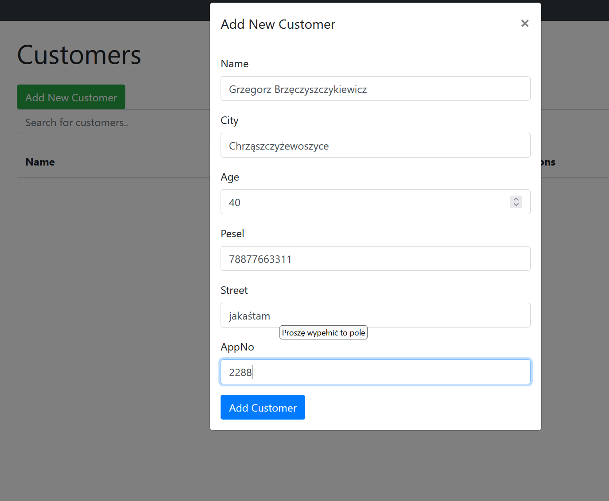
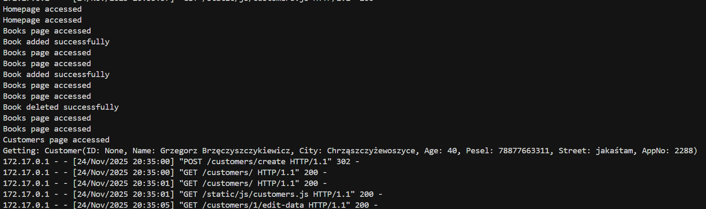
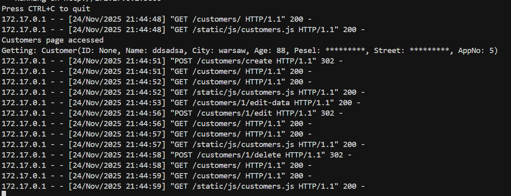
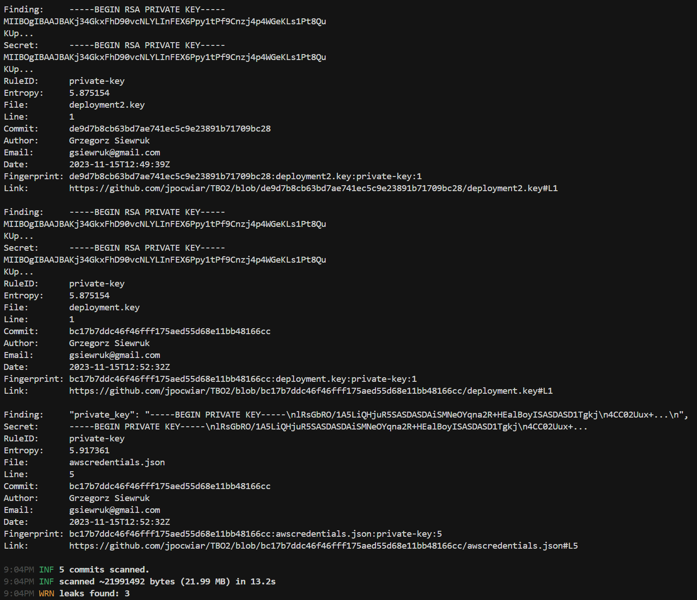
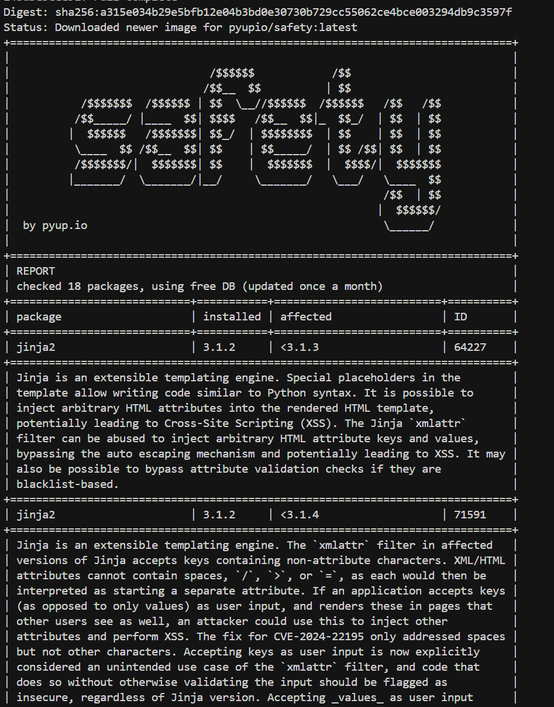

# Zadanie 1

Uruchomiono aplikację Python, dokonano kilku operacji dodania / edycji usunięcia książek oraz osób. W logach dockera zaobserwować można, że widoczne są dane wrażliwe tak jak Pesel i adres zamieszkania





dokonano następujących zmian w kodzie w pliku `models.py`, które maskują wrażliwe dane (PESEL i adres) w logach:

```diff
-        return f"Customer(ID: {self.id}, Name: {self.name}, City: {self.city}, Age: {self.age}, Pesel: {self.pesel}, Street: {self.street}, AppNo: {self.appNo})"
+        return f"Customer(ID: {self.id}, Name: {self.name}, City: {self.city}, Age: {self.age}, Pesel: {'*********'}, Street: {'*********'}, AppNo: {self.appNo})"
```

Dzięki tej zmianie wrażliwe dane są maskowane w logach aplikacji. Zdecydowano się na użycie stałej liczby gwiazdek celem jeszcze skuteczniejszego maskowania i prostoty w kodzie. Numer mieszkania pozostaje niezmieniony, ponieważ sam z siebie nie dostarcza użytecznej informacji i sam w logach może być użyteczny jako jeden ze znaków, że logi i zapisywane informacje działają prawidłowo.




# Zadanie 2

Użyto gitleaks do weryfikacji wycieku sekretów związanych z kontrolą wersji. Wykonanie komendy ukazało trzy wycieki poufnych danych, w tym klucz prywatny RSA i klucz prywatny w pliku konfiguracyjnym AWS. Te pliki dostępne są w historii commitów, więc nawet po usunięciu są dostępne w repozytorium.




Żaden z wykrytych sekretów nie jest fałszywym pozytywem.

# Zadanie 3

W ramach ostatniego zadania wykonano analizę z użyciem pyupio, w terminalu ukazał się następujący output opisujący podatności bibliotek jinja2, werkzeug, oraz healpy:


Jako najpoważniejszą wybrano podatność pakietu werkzeug. Debugger w Werkzeug (w wersjach < 3.0.3) pozwala atakującemu wykonać kod na maszynie dewelopera w określonych warunkach. Wymaga:
- Włączonego trybu debug w aplikacji
- Interakcji dewelopera z domeną/subdomeną kontrolowaną przez atakującego
- Wprowadzenia PIN debuggera
- Odgadnięcia URL w aplikacji, który wywoła debugger

W app.py:
```
if __name__ == '__main__':
    app.run(debug=True)
```
można zobaczyć, że tryb debug jest włączony, co jest podstawowym warunkiem do możliwości przeprowadzenia ataku. Prawdopodobieństwo ataku jest więc znaczne. W środowisku produkcyjnym tryb debug powinien być wyłączony. Warto jednak także zaktualizować bibliotekę do wersji bezpiecznej, w której te problemy zostały rozwiązane.