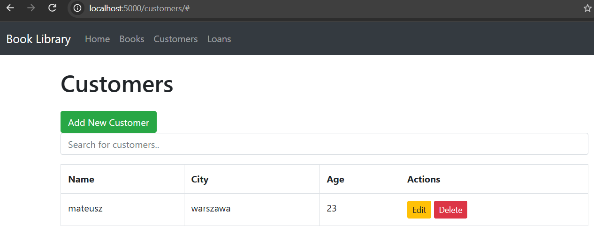
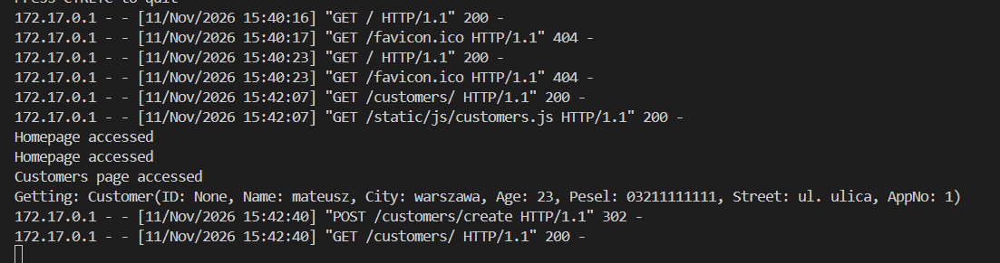
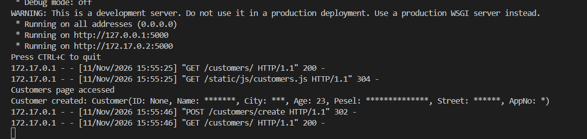
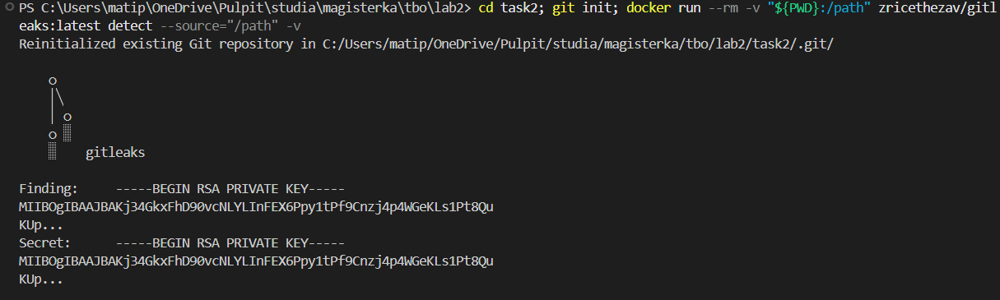
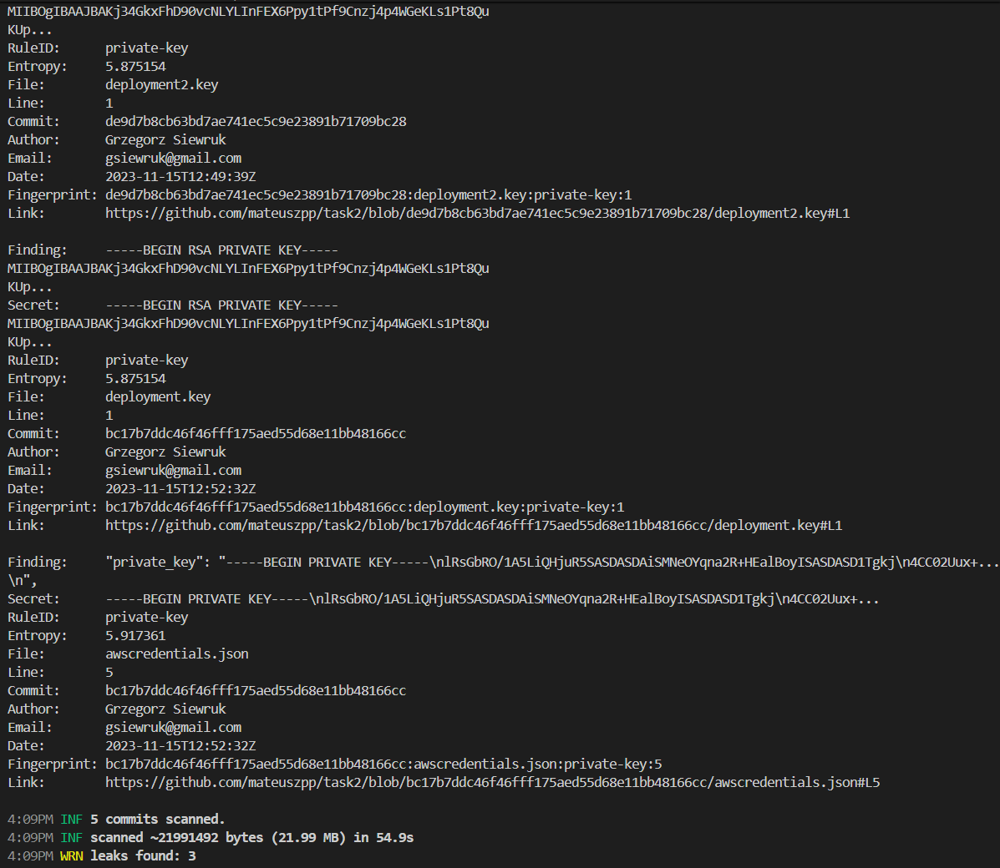
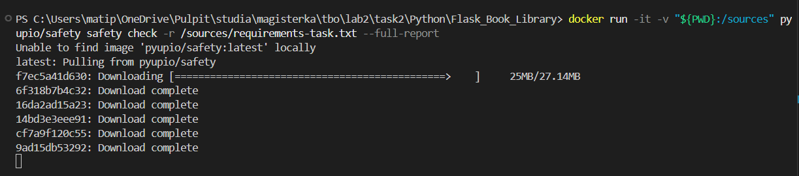

## Zadanie 1 

Celem zadania jest przetestowanie aplikacji oraz weryfikacja czy dane wrażliwe są odpowiednio przechowywane oraz czy są w sposób jawny zapiswane w logach.

Widok uruchomionej aplikacji.

Widok danych osobowych w logach.

Zidentyfikowałem, że wyciek danych wrażliwych (m.in. numeru PESEL) do logów następował w konstruktorze klasy `Customer` (`task2/Python/Flask_Book_Library/project/customers/models.py`), gdzie wywoływana była instrukcja `print("Getting: " + str(self), flush=True)`. Metoda `__repr__` tej klasy zwracała pełne dane obiektu, co prowadziło do ich zapisu w logach przy każdym tworzeniu instancji.

Zmodyfikowałem metodę `__repr__` tak, aby każde pole zawierające tekst (oprócz wieku, który jest liczbą) było maskowane za pomocą gwiazdek `*`. Dzięki temu w logach widać strukturę obiektu, ale nie widać rzeczywistych danych osobowych.

Takie podejście zachowuje pewną użyteczność logów (bo wiem, że akcja miała miejsce) przy jednoczesnym zapewnieniu ochrony danych osobowych.

Wprowadzone zmiany widoczne są na powyższym zdjęciu.

## Zadanie 2

Celem tego zadania jest weryfikacja, czy repozytorium oraz jego historia ujawniają jakieś sekrety bądź też hasła. Dane takie mogą być hardcodowane w kodzie źródłowym lub jakimś pliku na dysku.

Uruchomienie oprogramowania gitleaks

wynik oprogramowanie gitleaks

Po uruchomieniu kontenera,  dostajemy informację na temat wykrycia kluczy w następujących plikach:
- deployment2.key
- deployment.key
- awscredentials.json

  
Wraz z tymi wynikami przekazane są bezpośrednie linki do znalezionych sekretów, które wskazują na to, że nie są to false positivy:
- https://github.com/mateuszpp/task2/blob/de9d7b8cb63bd7ae741ec5c9e23891b71709bc28/deployment2.key#L1
- https://github.com/mateuszpp/task2/blob/bc17b7ddc46f46fff175aed55d68e11bb48166cc/deployment.key#L1
- https://github.com/mateuszpp/task2/blob/bc17b7ddc46f46fff175aed55d68e11bb48166cc/awscredentials.json#L5

Klucze te są dostępne publicznie dzięki historii git'a.

Należy użyć narzędzi do czyszczenia historii Git,  aby trwale usunąć te pliki z historii wszystkich branchy i tagów.
Po usunięciu sekretów z repozytorium należy przeprowadzić rotację wszystkich haseł i kluczy, które mogły zostać ujawnione.

## Zadanie 3

W pliku safety_results.txt umieściłem wynik narzędzia safety check.

Wśród podatności wykrytych przez narzędzie Safety najwyższą krytyczność posiada luka w bibliotece Jinja2 (zainstalowana wersja wg raportu to 3.1.2, ID: 75976, powiązana z CVE-2024-56201), sklasyfikowana jako podatność typu RCE / Sandbox Escape. Problem wynika z błędu w mechanizmie izolacji, w którym wbudowany filtr |attr omija standardowe reguły walidacji atrybutów. Umożliwia to nieuprawnione wyciągnięcie referencji do metody str.format i wykonanie dowolnego kodu w języku Python na serwerze.

Warunkiem koniecznym do wykorzystania tej luki jest bezpośrednia kontrola atakującego nad treścią przetwarzanego szablonu. Sytuacja taka występuje wyłącznie w systemach, które dynamicznie kompilują i uruchamiają niezaufane szablony nadesłane przez użytkowników w ramach Jinja. Wykorzystanie wymaga odwołania się do metody formatującej poprzez filtr |attr w kodzie szablonu.

W badanej aplikacji mechanizm SandboxedEnvironment nie jest w ogóle wykorzystywany, a szablony są statycznymi plikami serwerowymi, do których dane użytkowników trafiają wyłącznie jako zmienne kontekstowe. W związku z tym prawdopodobieństwo praktycznego wykorzystania tej podatności w analizowanym projekcie jest minimalne. W ramach działań naprawczych zaleca się jednak podniesienie wersji pakietu jinja2 do co najmniej 3.1.6.