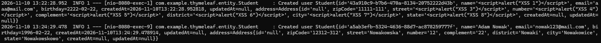
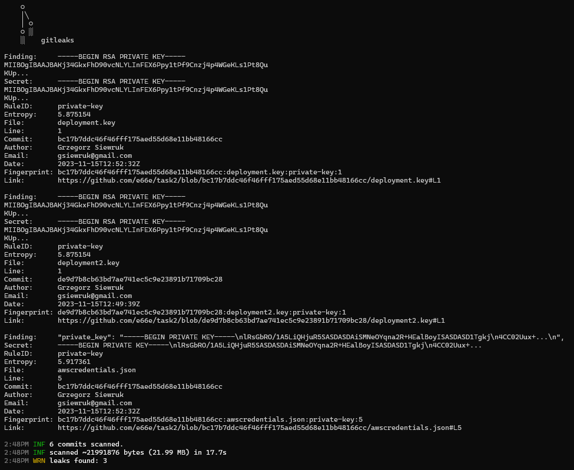

## Assignment 2 (wersja z Java)

## Zadanie 1

Na załączonym obrazku widać, że w logach zawierają się informacje poufne użytkownika, w tym przypadku adres zamieszkania, imie i nazwisko, data urodzenia.

Aby usunąć zagrażenie wycieku tych informacji, zostały zmienione nadpisane metody toString() dla klas Address i Student. Dla klasy Address ukryte zostały pola: zipCode, street, number, complement i district. Natomiast dla klasy Student ukryte zostały pola name i birthday (zmiany znajdują się w odpowiednich klasach w PR).

## Zadanie 2

Na powyższym obrazku znajduje się output gitleaks dla
